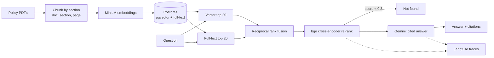

# PolicyRAG

Cited Q&A over insurance policies using hybrid search and re-ranking, traced in Langfuse and exposed as an MCP server.

Ask "How long is the waiting period for ShieldCare Health Plus?" and get the answer with its source (document, section, page), or "Not found in the policy documents." when retrieval is weak.

## Results

Retrieval on 30 questions over 12 policies (84 section chunks). Gold = the right document and section. Reproduce with `make eval`; no API key needed.

| Method | recall@1 | recall@5 | MRR |
|---|---|---|---|
| Vector only | 73.3% | 100.0% | 0.856 |
| Hybrid (RRF) | 83.3% | 100.0% | 0.917 |
| Hybrid + rerank | 96.7% | 100.0% | 0.983 |

recall@5 is saturated on a corpus this small, so recall@1 and MRR show the real lift: re-ranking adds 23.4 points of recall@1 over vector-only.

Out-of-scope check: the top re-rank probability is at least 0.77 for every in-scope question and 0.0 for six unrelated questions, so the 0.3 abstain threshold separates them cleanly.

Answer quality (answer match, citations, LLM-judged faithfulness) comes from `make eval-live`, which needs a free Gemini key and caches every response. Those numbers are not in this README yet because that run has not been done.

## Architecture



Served through FastAPI (`/ask`) and an MCP server (`search_policies`, `answer_question`).

## Run it

```bash
cp .env.example .env            # add a free Gemini key from Google AI Studio
docker compose up -d db
uv venv && uv pip install -e .
make eval                       # ingest + retrieval table
make serve                      # http://localhost:8000
```

Or everything in containers: `docker compose up`.

### MCP

```json
{ "mcpServers": { "policyrag": {
  "command": "uv", "args": ["run", "python", "-m", "policyrag.mcp_server"],
  "cwd": "/path/to/policyrag" } } }
```

## Stack

All free: Postgres + pgvector, local MiniLM embeddings, local bge-reranker-base, Gemini free tier for answers, Langfuse Hobby for traces, GitHub Actions for CI. Model responses are cached on disk by (model, prompt hash); CI replays them (`POLICYRAG_OFFLINE=1`).

## Corpus

Twelve synthetic policy wordings (health, auto, home, travel, life, renters, pet, critical illness, cyber, commercial, senior health, umbrella) generated by `corpus/generate.py`. Every document uses the same section layout, so retrieval has to tell look-alike clauses apart by product name and figures. No employer or customer data.

## What I'd do next

1. Swap in real public policy wordings; clause-level gold labels would make recall@5 informative again.
2. Add a no-answer eval set to measure abstention precision, not just score separation.
3. Run `make eval-live` and commit `eval/cache` so faithfulness numbers replay in CI.
